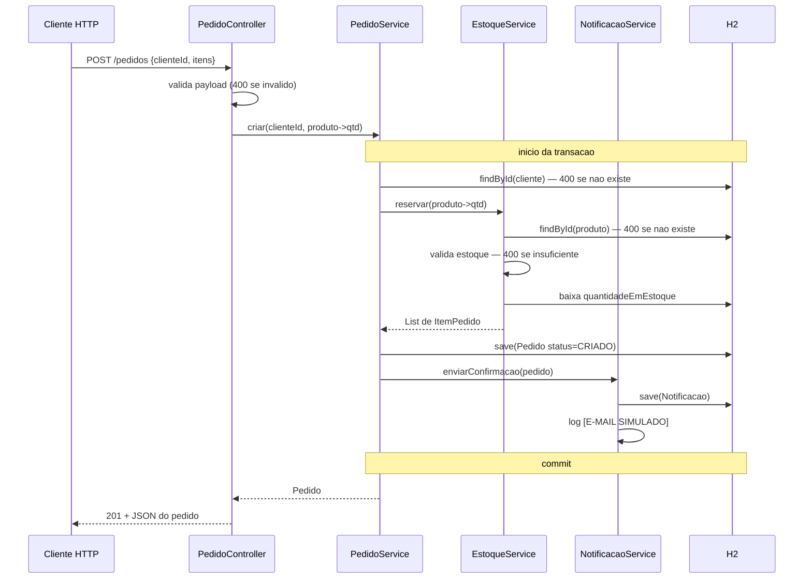

# Arquitetura do monolito

Como o `ecommerce-monolito` esta organizado hoje, antes da decomposicao.
Para rodar e chamar os endpoints, veja o [README](../README.md).

## Visao geral

Um unico deploy, um unico banco, um unico processo. Nao ha fila, cache, gateway
nem chamada de rede saindo da aplicacao — tudo o que acontece num `POST /pedidos`
acontece dentro da mesma JVM e da mesma transacao.

```
                    HTTP
                     |
        +------------v-------------+
        |     PedidoController     |   valida payload, monta o mapa produto->qtd
        +------------+-------------+
                     |
        +------------v-------------+
        |      PedidoService       |   @Transactional  <-- a fronteira transacional
        +--+---------+----------+--+
           |         |          |
   +-------v--+  +---v------+   +v------------------+
   | Cliente  |  | Estoque  |   | NotificacaoService|
   |Repository|  | Service  |   | (chamada direta)  |
   +----------+  +---+------+   +---+---------------+
                     |              |
              +------v-----+  +-----v------------+
              |  Produto   |  |   Notificacao    |
              | Repository |  |   Repository     |
              +------+-----+  +-----+------------+
                     |              |
                +----v--------------v---+
                |     H2 (em memoria)   |   um schema so
                +-----------------------+
```

## Camadas

Quatro pacotes dentro de `goon.spring.ecommerce`, sem separacao de modulo ou de
deploy:

| pacote       | responsabilidade                                                        |
|--------------|-------------------------------------------------------------------------|
| `controller` | Traduz HTTP para chamada de servico. Valida o formato do payload, nao regra de negocio. |
| `service`    | Regra de negocio e fronteira transacional.                              |
| `repository` | Spring Data JPA, um `JpaRepository` por entidade persistida. Nenhuma query customizada ate agora. |
| `model`      | Entidades JPA. Sao tambem o que a API serializa — nao ha DTO de resposta. |

Os DTOs de entrada (`PedidoRequest`, `ItemRequest`) sao `record`s aninhados no
proprio `PedidoController`, porque so ele os usa.

## Modelo de dados

```
CLIENTE ---1:N--- PEDIDO ---1:N--- ITEM_PEDIDO ---N:1--- PRODUTO
                     ^
                     |
                    1:N
                     |
                NOTIFICACAO
```

- **Cliente** — `nome`, `email`. O e-mail e o que o `NotificacaoService` usa.
- **Produto** — `nome`, `preco`, `quantidadeEmEstoque`. O estoque e mutado
  diretamente na entidade gerenciada; nao existe entidade de movimentacao.
- **Pedido** — `cliente`, `itens`, `valorTotal`, `status` (`CRIADO` /
  `CANCELADO`). O `valorTotal` e calculado no construtor e persistido, nao
  recalculado na leitura.
- **ItemPedido** — `produto`, `quantidade`, `precoUnitario`. O preco e copiado
  do produto no momento da compra, entao alterar o preco depois nao muda pedidos
  ja fechados.
- **Notificacao** — `pedido`, `destinatario`, `tipo`, `enviadoEm`. Historico do
  que foi "enviado".

O schema e criado pelo Hibernate (`ddl-auto: create-drop`) e populado pelo
`data.sql` a cada boot. Nao ha migracao versionada (Flyway/Liquibase): o banco e
descartavel de proposito, para o exercicio comecar sempre do mesmo estado.

## Fluxo: `POST /pedidos`



`PATCH /pedidos/{id}/cancelar` segue o mesmo desenho na direcao oposta: carrega
o pedido (404 se nao existe), recusa se ja nao estiver `CRIADO` (400), devolve o
estoque item a item, marca `CANCELADO` e chama `enviarCancelamento`.

## Transacao e consistencia

`PedidoService.criar` e `PedidoService.cancelar` sao `@Transactional`. Isso quer
dizer que **tudo** — baixa de estoque, insercao do pedido e dos itens, insercao
da notificacao — commita junto ou rola back junto. Se qualquer passo falhar, o
banco volta ao estado anterior e o cliente recebe um erro.

Essa atomicidade e a coisa mais valiosa que o monolito tem hoje, e e exatamente
o que se perde ao separar servicos. Vale notar que ela cobre a persistencia, mas
nao o "envio" do e-mail: o log ja saiu quando o rollback acontece. Com um
`kafkaTemplate.send()` no lugar do log, isso deixa de ser cosmetico e vira um
dual-write de verdade.

## Tratamento de erro

Nao ha `@ControllerAdvice`. Os servicos lancam `ResponseStatusException`
diretamente com o status ja escolhido (400 para regra de negocio, 404 para
pedido inexistente), e o Spring transforma em resposta HTTP. E o suficiente
enquanto ha um controller so; um segundo endpoint com regras diferentes ja
justificaria centralizar.

Validacao de payload e feita com `if`s no controller, sem
`spring-boot-starter-validation` / Bean Validation — tres checagens nao pagam a
dependencia.

## Onde estao os acoplamentos propositais

Este monolito foi montado para ser dificil de separar nos lugares certos. Os
quatro pontos de atrito, e a pergunta que cada um forca:

| # | Acoplamento | Onde | A pergunta que ele levanta |
|---|-------------|------|----------------------------|
| 1 | Chamada direta e sincrona | `PedidoService` -> `NotificacaoService` | O caller precisa esperar a notificacao? O que devolver se ela falhar? |
| 2 | Banco compartilhado, com FK | `Notificacao.pedido` -> `PEDIDO` | De quem e a tabela `NOTIFICACAO`? Como separar o schema sem perder a FK? |
| 3 | Dois tipos de evento | `enviarConfirmacao` e `enviarCancelamento` | Um topico ou dois? Como versionar o payload? Como garantir que o cancelamento nao seja processado antes da criacao? |
| 4 | Dados de outro agregado | `Cliente.nome` / `Cliente.email` dentro da notificacao | Evento gordo com o e-mail dentro, chamada sincrona de volta ao monolito, ou copia local dos clientes no microsservico? |

E o dual-write descrito acima, que aparece assim que o (1) virar publicacao em
topico: mensagem publicada + transacao com rollback. Esse e o caso de uso
canonico do padrao **outbox**.

Nenhum desses pontos deve ser "corrigido" no monolito — eles sao o enunciado.

## O que o monolito deliberadamente nao tem

Nada disso e esquecimento; a ausencia mantem o exercicio focado.

- Autenticacao, autorizacao e qualquer nocao de usuario logado.
- `GET` de pedidos ou produtos (so o console do H2 para inspecionar).
- Paginacao, filtros, ordenacao.
- DTOs de resposta — a API serializa as entidades.
- Migracao de schema versionada.
- Reserva de estoque com lock ou controle de concorrencia: duas requisicoes
  simultaneas para o ultimo item do estoque podem passar as duas. Em producao
  isso seria um lock pessimista ou uma coluna de versao; aqui seria ruido.
- Metricas, tracing, health check customizado.
